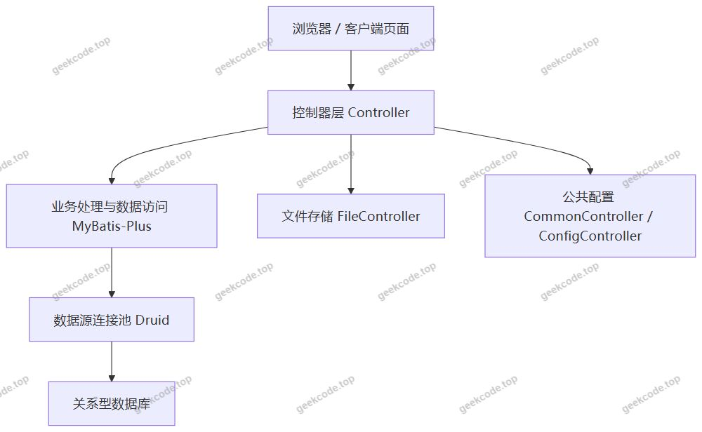
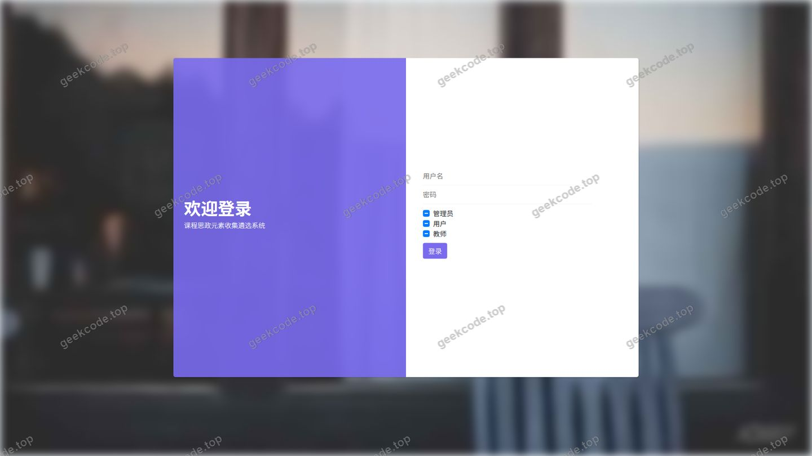
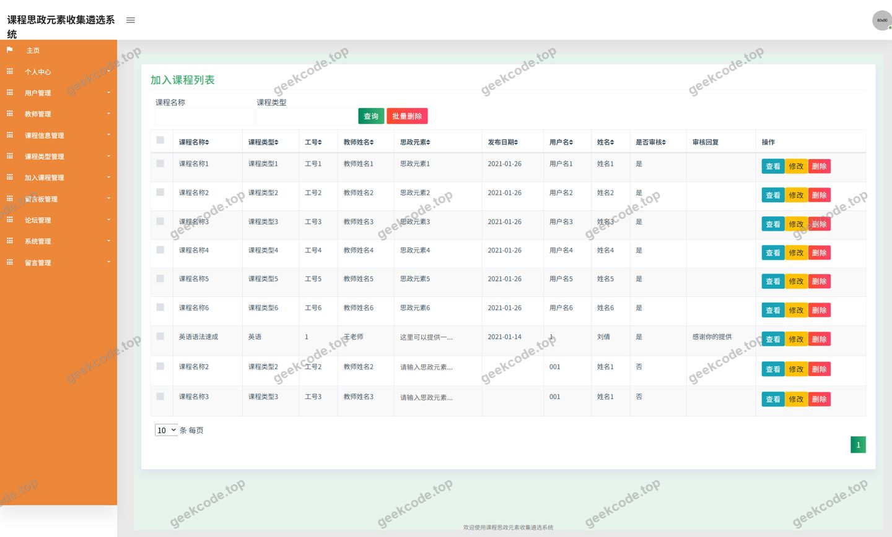
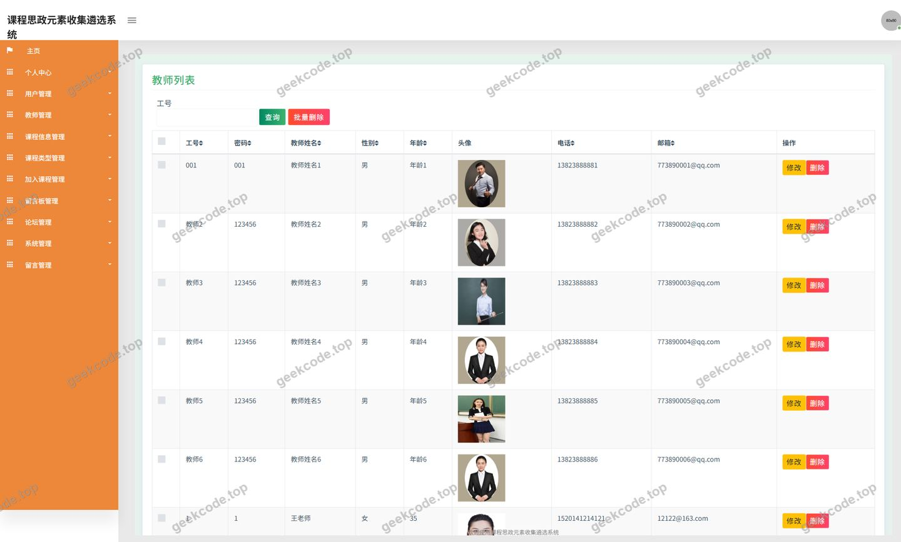
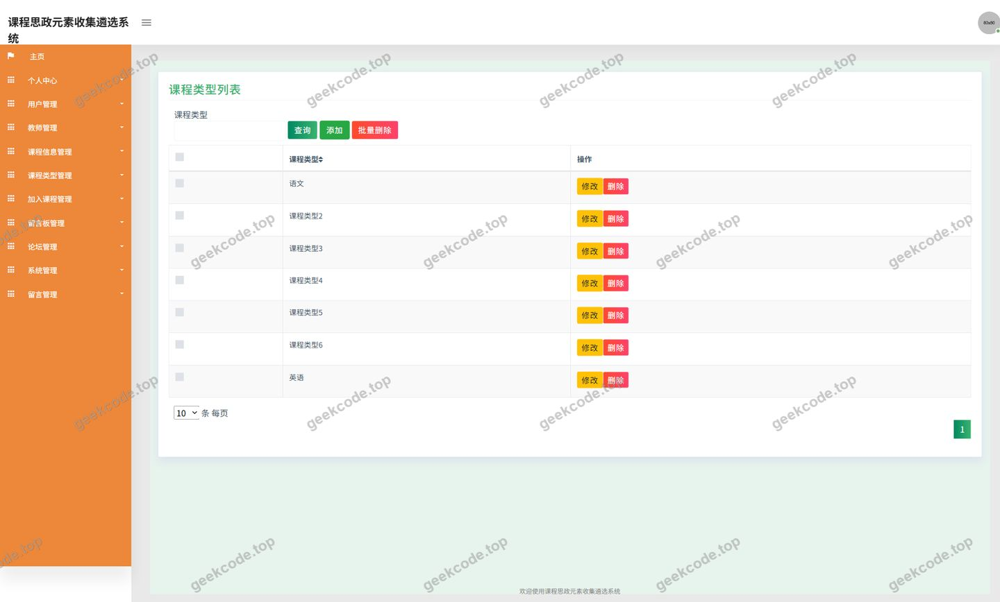
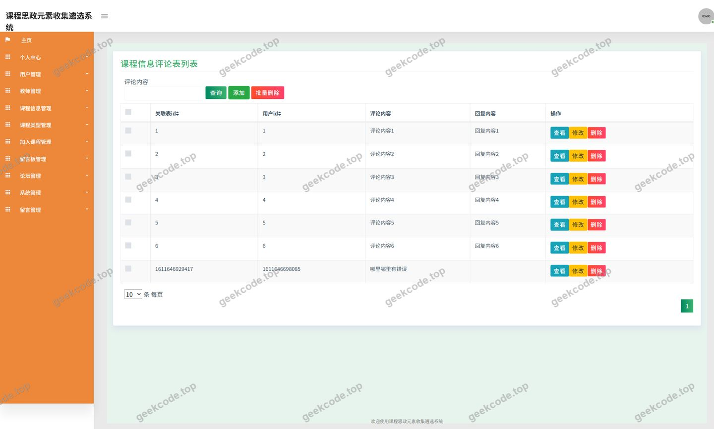
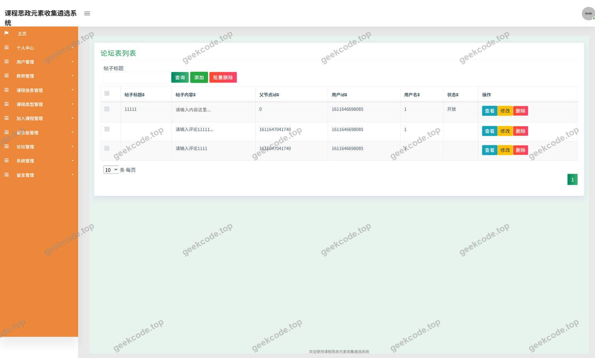
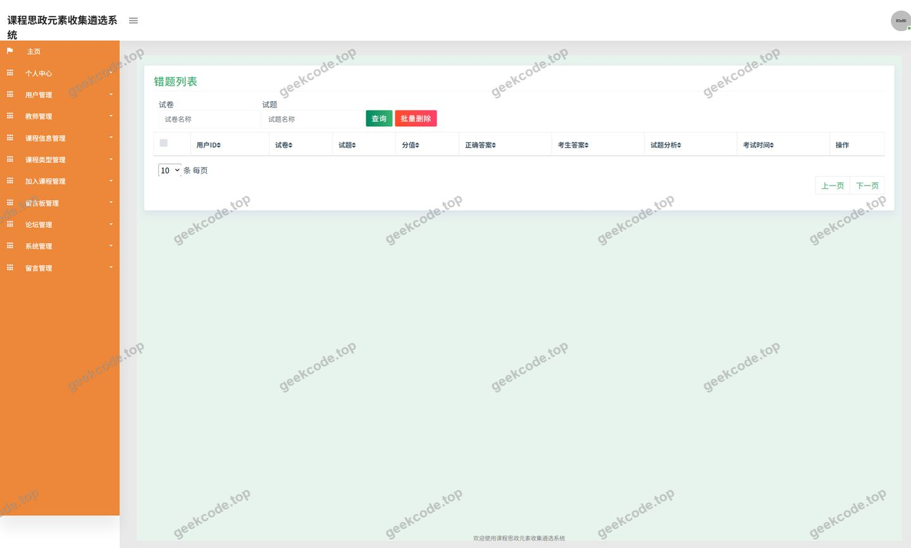
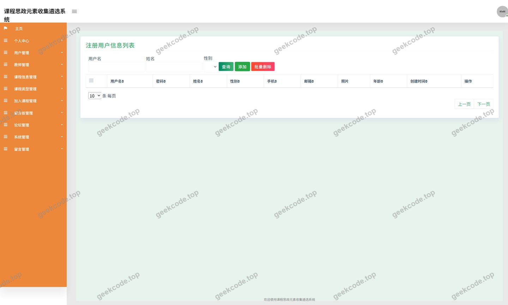
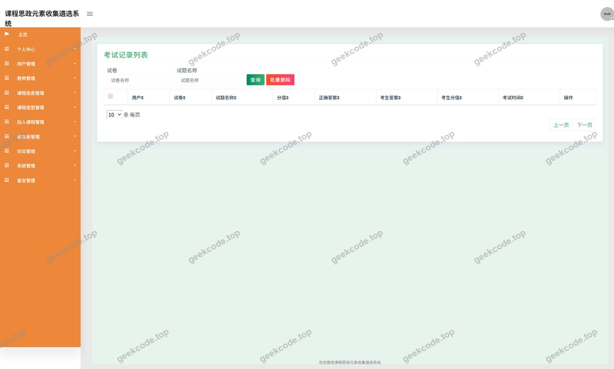

# java项目ssm课程思政元素收集遴选系统java毕业设计

> 🎓 **计算机毕业设计 · java项目ssm课程思政元素收集遴选系统java毕业设计**
>
> 本仓库只放**项目介绍 + 运行截图**（截图是站点带水印的原图，存在仓库 `images/` 里）。
>
> 👉 **完整可运行源码 / 数据库脚本 / 部署文档：[点我获取](https://geekcode.top/archives/java%E9%A1%B9%E7%9B%AEssm%E8%AF%BE%E7%A8%8B%E6%80%9D%E6%94%BF%E5%85%83%E7%B4%A0%E6%94%B6%E9%9B%86%E9%81%B4%E9%80%89%E7%B3%BB%E7%BB%9Fjava%E6%AF%95%E4%B8%9A%E8%AE%BE%E8%AE%A1?utm_source=github)**
>
> 💬 咨询微信：**ir9372**　|　🌐 更多项目：[极客代码 geekcode.top](https://geekcode.top/?utm_source=github)
>
> 📌 项目详情页：<https://geekcode.top/archives/java%E9%A1%B9%E7%9B%AEssm%E8%AF%BE%E7%A8%8B%E6%80%9D%E6%94%BF%E5%85%83%E7%B4%A0%E6%94%B6%E9%9B%86%E9%81%B4%E9%80%89%E7%B3%BB%E7%BB%9Fjava%E6%AF%95%E4%B8%9A%E8%AE%BE%E8%AE%A1?utm_source=github>

<table><td width="230" align="center"> <b>扫码加微信 ir9372</b></td><td valign="middle">📦 源码 = 项目介绍 + 全部运行截图 + 数据库 + 部署文档 👉 点上方任意截图，直接跳到 <b>极客代码 geekcode.top</b> 详情页</td></table>

---

<h1>java项目_ssm课程思政元素收集遴选系统_java毕业设计</h1>
<h2>项目概述</h2>

课程思政元素收集遴选系统是一个面向高校课程思政建设场景的后端服务型项目，主要用于课程思政相关信息的收集、整理与遴选。系统以“课程信息”为核心业务对象，围绕课程类型划分、教师信息维护、学生加入课程、课程评论互动、论坛交流、留言反馈、资源收藏等环节构建数据链路，为课程思政元素的汇聚与筛选提供信息化支撑。

系统采用 Spring MVC 分层架构，控制器层统一暴露接口，持久层使用 MyBatis-Plus 完成对象关系映射与通用 CRUD，数据源由 Druid 连接池统一管理，具备连接池监控与 SQL 性能统计能力。项目共包含 12 个控制器，覆盖用户、教师、课程信息、课程类型、加入课程、课程评论、论坛、留言反馈、收藏、文件、公共接口与系统配置等业务域。

适用人群包括高校课程思政建设管理者、任课教师与在校学生：教师可发布与维护课程信息，学生可浏览课程、加入课程、参与评论与论坛讨论，管理端可对用户、教师、课程类型及各业务数据进行统一维护。

<h2>技术架构</h2>
<h3>整体架构</h3>

项目为纯接口服务型工程，未配置独立的前台或后台路由，页面通过调用后端接口获取数据。整体采用经典的三层结构：

控制器层由 <code>UserController</code>、<code>JiaoshiController</code>、<code>KechengxinxiController</code>、<code>KechengleixingController</code>、<code>JiarukechengController</code>、<code>DiscusskechengxinxiController</code>、<code>ForumController</code>、<code>MessagesController</code>、<code>StoreupController</code>、<code>FileController</code>、<code>CommonController</code>、<code>ConfigController</code> 组成，按业务实体划分职责，接口路径与实体名称一一对应，便于维护与扩展。

<h3>核心技术选型</h3>
<table>
<thead>
<tr>
<th>技术</th>
<th>作用</th>
<th>选型理由</th>
</tr>
</thead>
<tbody><tr>
<td>Spring Core / Beans / Context</td>
<td>容器与依赖注入</td>
<td>提供 IoC 容器与 Bean 生命周期管理，降低组件间耦合</td>
</tr>
<tr>
<td>Spring MVC（spring-web、spring-webmvc）</td>
<td>请求分发与接口暴露</td>
<td>基于注解的控制器开发模式，接口定义清晰，便于前后端分离调用</td>
</tr>
<tr>
<td>Spring AOP</td>
<td>横切逻辑处理</td>
<td>支持日志、事务等横切关注点与业务代码解耦</td>
</tr>
<tr>
<td>Spring JDBC / TX</td>
<td>数据访问与事务管理</td>
<td>提供事务边界控制与底层 JDBC 支持</td>
</tr>
<tr>
<td>MyBatis-Plus</td>
<td>持久层 ORM 框架</td>
<td>内置通用 Mapper 与条件构造器，减少单表 CRUD 重复代码，提升开发效率</td>
</tr>
<tr>
<td>Druid</td>
<td>数据库连接池</td>
<td>具备连接池监控、SQL 执行统计与慢 SQL 记录能力，便于运行期调优</td>
</tr>
<tr>
<td>JUnit</td>
<td>单元测试</td>
<td>为业务逻辑与数据访问提供测试支撑</td>
</tr>
</tbody></table>
<h3>数据库设计要点</h3>

根据控制器命名可确定系统围绕以下数据实体建模：用户、教师、课程信息、课程类型、加入课程、课程信息评论、论坛、留言反馈、收藏、文件、系统配置。设计要点如下：

<ul>
<li>课程信息与课程类型为多对一关系，通过类型标识关联，便于按类型筛选课程资源；</li>
<li>教师信息独立建模，课程信息与教师建立归属关系，支撑教师维度统计；</li>
<li>加入课程作为用户与课程之间的关联实体，记录用户选课关系，是“我的课程”数据来源；</li>
<li>课程信息评论依附于课程信息，形成课程维度的互动数据；</li>
<li>收藏实体采用通用收藏模型，通过收藏类型与目标标识区分收藏对象，服务于“我的收藏”；</li>
<li>文件实体统一记录上传文件的存储信息，供课程资料、论坛附件等场景复用；</li>
<li>系统配置以键值形式存储，支撑公共参数与字典类数据的集中维护。</li>
</ul>
<h2>功能模块</h2>
<h3>前台用户端</h3>
<table>
<thead>
<tr>
<th>模块</th>
<th>对应控制器</th>
<th>功能描述</th>
</tr>
</thead>
<tbody><tr>
<td>登录</td>
<td><code>UserController</code></td>
<td>提供用户身份校验与登录态获取接口</td>
</tr>
<tr>
<td>课程信息</td>
<td><code>KechengxinxiController</code></td>
<td>课程信息列表查询、详情查看，支持按课程类型筛选</td>
</tr>
<tr>
<td>课程类型</td>
<td><code>KechengleixingController</code></td>
<td>课程类型列表查询，用于课程分类导航</td>
</tr>
<tr>
<td>教师信息</td>
<td><code>JiaoshiController</code></td>
<td>教师信息查询，展示课程所属教师资料</td>
</tr>
<tr>
<td>加入课程</td>
<td><code>JiarukechengController</code></td>
<td>用户加入课程、查询已加入课程、退出课程</td>
</tr>
<tr>
<td>课程信息评论</td>
<td><code>DiscusskechengxinxiController</code></td>
<td>针对具体课程发表评论、查看评论列表</td>
</tr>
<tr>
<td>论坛信息</td>
<td><code>ForumController</code></td>
<td>论坛帖子发布、列表浏览、帖子详情查看</td>
</tr>
<tr>
<td>留言反馈</td>
<td><code>MessagesController</code></td>
<td>提交留言反馈、查看反馈记录与回复</td>
</tr>
<tr>
<td>我的收藏</td>
<td><code>StoreupController</code></td>
<td>收藏课程或论坛内容、取消收藏、查询收藏列表</td>
</tr>
<tr>
<td>我的发布</td>
<td><code>ForumController</code></td>
<td>查询当前用户发布的论坛帖子</td>
</tr>
<tr>
<td>个人中心</td>
<td><code>UserController</code></td>
<td>查看与修改个人资料、修改登录密码</td>
</tr>
<tr>
<td>文件上传</td>
<td><code>FileController</code></td>
<td>上传课程资料、论坛图片等附件并返回访问地址</td>
</tr>
<tr>
<td>考试记录</td>
<td>截图可见“kaoshijilu”页面</td>
<td>展示考试记录页面，具体业务字段根据现有信息无法确定</td>
</tr>
</tbody></table>
<h3>后台管理端</h3>

系统中未配置后台路由，管理功能通过对应实体的控制器接口提供，截图中可见用户、教师、课程类型、加入课程、论坛、课程信息评论等管理页面，主要管理模块如下：

<table>
<thead>
<tr>
<th>模块</th>
<th>对应控制器</th>
<th>功能描述</th>
</tr>
</thead>
<tbody><tr>
<td>用户管理</td>
<td><code>UserController</code></td>
<td>用户信息的查询、新增、修改、删除</td>
</tr>
<tr>
<td>默认用户</td>
<td>截图可见“defaultuser”页面</td>
<td>默认用户相关页面的数据维护</td>
</tr>
<tr>
<td>教师管理</td>
<td><code>JiaoshiController</code></td>
<td>教师信息的新增、编辑、删除与查询</td>
</tr>
<tr>
<td>课程信息管理</td>
<td><code>KechengxinxiController</code></td>
<td>课程信息的新增、编辑、删除、审核与查询</td>
</tr>
<tr>
<td>课程类型管理</td>
<td><code>KechengleixingController</code></td>
<td>课程类型的维护与查询</td>
</tr>
<tr>
<td>加入课程管理</td>
<td><code>JiarukechengController</code></td>
<td>查看与管理用户选课记录</td>
</tr>
<tr>
<td>课程评论管理</td>
<td><code>DiscusskechengxinxiController</code></td>
<td>查看、审核与删除课程评论</td>
</tr>
<tr>
<td>论坛管理</td>
<td><code>ForumController</code></td>
<td>帖子查看、内容维护与删除</td>
</tr>
<tr>
<td>留言反馈管理</td>
<td><code>MessagesController</code></td>
<td>查看用户留言并回复处理</td>
</tr>
<tr>
<td>收藏管理</td>
<td><code>StoreupController</code></td>
<td>查看与维护用户收藏记录</td>
</tr>
<tr>
<td>文件管理</td>
<td><code>FileController</code></td>
<td>上传文件的存储与访问</td>
</tr>
<tr>
<td>系统配置</td>
<td><code>ConfigController</code></td>
<td>系统参数配置的读取与更新</td>
</tr>
<tr>
<td>公共接口</td>
<td><code>CommonController</code></td>
<td>提供下拉字典、通用查询等公共能力</td>
</tr>
</tbody></table>
<h2>用户角色与权限</h2>

系统根据业务实体与截图页面可确定三类角色：管理员、教师、普通用户（学生）。

<h3>管理员</h3>
<ul>
<li>用户管理：查询、新增、修改、删除用户信息，维护默认用户数据；</li>
<li>教师管理：维护教师档案信息；</li>
<li>课程信息管理：新增、编辑、删除课程信息，管理课程所属类型与授课教师；</li>
<li>课程类型管理：维护课程分类体系；</li>
<li>加入课程管理：查看并管理用户选课记录；</li>
<li>课程评论管理：查看与处理课程信息评论；</li>
<li>论坛管理：查看、维护与删除论坛帖子；</li>
<li>留言反馈管理：查看用户留言并进行回复；</li>
<li>收藏管理：查看与维护用户收藏记录；</li>
<li>文件管理：管理上传文件的存储与访问；</li>
<li>系统配置：维护系统公共参数。</li>
</ul>
<h3>教师</h3>
<ul>
<li>课程信息：发布与维护本人课程信息，查看课程详情；</li>
<li>课程类型：查询课程分类，用于课程归类；</li>
<li>加入课程：查看选择本人课程的学生记录；</li>
<li>课程信息评论：查看与回复课程评论；</li>
<li>论坛信息：发布帖子、参与讨论、查看我的发布；</li>
<li>留言反馈：提交反馈并查看处理结果；</li>
<li>我的收藏：收藏课程与论坛内容并管理收藏列表；</li>
<li>个人中心：维护个人资料与登录密码；</li>
<li>文件上传：上传课程资料附件。</li>
</ul>
<h3>普通用户（学生）</h3>
<ul>
<li>课程信息：浏览课程列表与详情；</li>
<li>课程类型：按类型筛选课程；</li>
<li>教师信息：查看授课教师资料；</li>
<li>加入课程：加入课程并查询已加入课程；</li>
<li>课程信息评论：发表课程评论、查看评论列表；</li>
<li>论坛信息：发布帖子、浏览与回复讨论、查看我的发布；</li>
<li>留言反馈：提交留言反馈、查看回复；</li>
<li>我的收藏：收藏课程或论坛内容、取消收藏；</li>
<li>个人中心：查看与修改个人资料、修改密码；</li>
<li>考试记录：查看考试记录页面；</li>
<li>文件上传：上传个人附件。</li>
</ul>
<h2>项目特色与创新点</h2>
<ol>
<li>
<strong>围绕课程思政元素构建数据闭环</strong>。系统以课程信息为核心，串联课程类型、教师、加入课程、课程评论、收藏等实体，形成“课程发布—分类归属—教师关联—学生加入—评论互动—收藏遴选”的完整链路，使课程思政元素的收集与筛选具备结构化数据支撑。

</li>
<li>
<strong>多维度互动数据支撑遴选决策</strong>。课程评论、论坛讨论、留言反馈三类互动数据从不同角度反映课程资源的使用情况与认可程度，为思政元素的遴选提供可量化的参考依据。

</li>
<li>
<strong>通用收藏模型提升数据复用性</strong>。收藏模块通过类型标识区分收藏对象，同一套逻辑同时服务课程与论坛内容，减少重复建模，便于后续扩展新的可收藏对象。

</li>
<li>
<strong>统一的文件与配置管理能力</strong>。文件控制器集中处理附件上传与访问，配置控制器集中管理系统参数，避免各业务模块重复实现公共能力。

</li>
<li>
<strong>持久层开发效率与运行期可观测性兼顾</strong>。MyBatis-Plus 提供通用 CRUD 与条件构造能力，显著降低单表操作代码量；Druid 连接池提供 SQL 监控与连接池状态查看能力，便于开发与运维阶段定位性能问题。

</li>
<li>
<strong>接口化的服务形态便于多端接入</strong>。项目以控制器接口对外提供服务，业务逻辑与展示层解耦，可同时支撑 Web 页面与其它客户端的接入需求。

</li>
</ol>
<h2>部署环境</h2>
<table>
<thead>
<tr>
<th>类别</th>
<th>要求</th>
</tr>
</thead>
<tbody><tr>
<td>JDK</td>
<td>需安装 JDK，具体版本根据现有信息无法确定，建议使用与 Spring 框架版本匹配的 JDK 8 及以上版本</td>
</tr>
<tr>
<td>构建工具</td>
<td>Maven，用于依赖管理与项目打包</td>
</tr>
<tr>
<td>Web 容器</td>
<td>基于 spring-webmvc 的 Web 应用，需部署于 Servlet 容器（如 Tomcat）中运行</td>
</tr>
<tr>
<td>数据库</td>
<td>关系型数据库（常见为 MySQL），需提前建库并初始化表结构与基础数据</td>
</tr>
<tr>
<td>连接池</td>
<td>Druid，通过配置文件配置数据库连接地址、账号、密码及连接池参数</td>
</tr>
<tr>
<td>持久层</td>
<td>MyBatis-Plus，需配置实体扫描与 Mapper 映射</td>
</tr>
<tr>
<td>测试环境</td>
<td>JUnit，用于运行单元测试</td>
</tr>
<tr>
<td>浏览器</td>
<td>支持现代标准的浏览器，用于访问系统页面</td>
</tr>
<tr>
<td>前端运行环境</td>
<td>根据现有信息无法确定具体前端框架与构建工具，项目未配置前台与后台路由</td>
</tr>
<tr>
<td>端口与访问</td>
<td>部署后通过 Servlet 容器配置的端口访问系统接口与页面</td>
</tr>
</tbody></table>
<h2>五、技术特性</h2>
<ul>
<li>使用 MyBatis-Plus 简化数据访问层开发</li>
</ul>
<h2>六、功能模块截图</h2>
<h3>后台管理端</h3>
<h4>页面-登录</h4>

<h4>页面-加入课程</h4>

<h4>页面-教师</h4>

<h4>页面-课程类型</h4>

<h4>页面-课程信息评论</h4>

<h4>页面-论坛</h4>

<h4>页面-用户</h4>

<h4>页面-defaultuser</h4>

<h4>页面-kaoshijilu</h4>

---

## 获取完整源码

| 项目 | 说明 |
| --- | --- |
| 项目名 | java项目ssm课程思政元素收集遴选系统java毕业设计 |
| 运行截图 | 本文 10 张（站点带水印原图，仓库 `images/` 目录） |
| 完整源码 | [https://geekcode.top/archives/java%E9%A1%B9%E7%9B%AEssm%E8%AF%BE%E7%A8%8B%E6%80%9D%E6%94%BF%E5%85%83%E7%B4%A0%E6%94%B6%E9%9B%86%E9%81%B4%E9%80%89%E7%B3%BB%E7%BB%9Fjava%E6%AF%95%E4%B8%9A%E8%AE%BE%E8%AE%A1?utm_source=github](https://geekcode.top/archives/java%E9%A1%B9%E7%9B%AEssm%E8%AF%BE%E7%A8%8B%E6%80%9D%E6%94%BF%E5%85%83%E7%B4%A0%E6%94%B6%E9%9B%86%E9%81%B4%E9%80%89%E7%B3%BB%E7%BB%9Fjava%E6%AF%95%E4%B8%9A%E8%AE%BE%E8%AE%A1?utm_source=github) |
| 咨询微信 | **ir9372**（备注：jingpin-yuanma） |
| 更多项目 | [极客代码 geekcode.top](https://geekcode.top/?utm_source=github) |

> 需要源码、部署、改配置、跑不起来等问题，加微信 ir9372 沟通，说明项目名即可。
